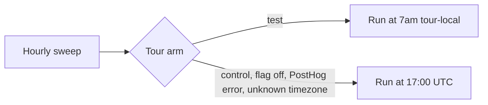
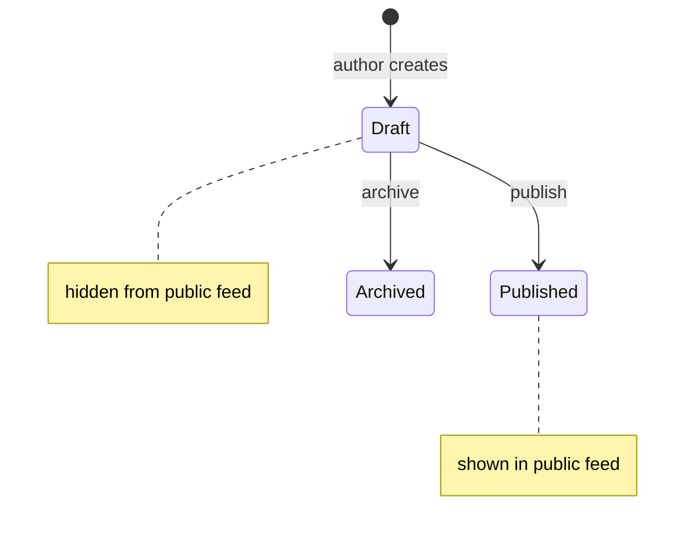

# Commits

- Commit locally, never push. `git commit && git push` counts as a push.
- Conventional Commits subject: `type(scope): summary`, scope optional
  (`feat(auth): add login redirect`). Types: feat, fix, refactor, docs,
  test, chore, perf, ci, build.
- One logical change per commit, in dependency order (model, plumbing,
  feature). Each commit leaves the tree working.
- Review feedback goes in a new commit on top. Amend only pre-review.
- Over 400 changed lines: split into a stack, per the `pr-stacks` skill.

# PR

Always `gh pr create --draft`. Use the repo's PR template when one exists and
map the sections below onto its headings. Drop template sections that do not
apply. Carry the ticket link and the links it contains.

```markdown
## Summary

<one sentence: what the user sees change, in product terms>

<one diagram: inputs and results, about 5 nodes>

- **<key term>:** <the idea, in a few words>

## Evidence

- **Before:** <screenshot or output from the running app>
  **After:** <screenshot or output from the running app>
```

Skip all preambles. Use the product's domain language.

## Summary

One effect sentence, one diagram, then bullets.

- **Effect sentence:** what changes for the user. "Unpublished posts stay
  out of the public feed until the author publishes."
- **Diagram:** a summary for a reader who has not opened the diff: the
  inputs and the results, about 5 nodes and one decision. A bigger draft is
  drawing the code: merge branches that share a result into one edge and
  list the cases on its label, and move guards, fallbacks and error paths
  into the bullets. Product names, "Run at 7am tour-local", over code
  names, `queue_agent_run require_eligible`. A paragraph that explains how
  parts interact or which state leads where is a diagram not yet drawn:
  draw it, and the paragraph goes.
- **Bullets:** each one a headline: a **bold key term** and a few words
  that carry the whole idea. A bullet earns its place only when the
  reviewer cannot read it in the diff: a choice that differs from the
  ticket, or a constraint. A one-mechanism change has zero or one. Status
  and follow-ups live in the ticket.
  "**Header button kept:** avoids a layout shift once loading ends."

### Find the shape first

Name the shape of the change, then draw that shape at summary size. Done
when a reader can say what the PR changes from the diagram alone, in one
sentence. GitHub renders Mermaid in PR bodies.

| Shape of the change | Draw it as |
|---|---|
| Parts calling each other in order | Mermaid `sequenceDiagram` |
| States and the transitions between them | Mermaid `stateDiagram-v2`, with a note per state naming its product effect |
| A decision or a data flow with branches | Mermaid `flowchart`, `LR` for short flows |
| Logic or an algorithm | Pseudocode |
| Structure that changes shape (tree, call stack, component tree) | `diff` of that tree |
| Who owns what after a refactor | Shallow file tree, one comment per folder |



The flag lookup and the unknown-timezone fallback behind this diagram are
bullets, so the diagram stays at four nodes.



```diff
 <SessionPage>
   useSessionEvents()
   <SessionToolbar>
+    <RunSkillButton />
   <SessionTimeline>
+    <SkillResultCard />
```

```diff
 src/
 ├── commands/
+│   └── show-me.ts       # expands the slash command
 ├── sessions/
-└── transport.ts
+└── transport/
+    ├── client.ts
+    └── stream.ts
```

The mechanism diagram leads. A `diff` of the call tree is the code map: add
it second, only when the reviewer needs it to find their way in the diff.
Two visuals is the ceiling.

## Evidence

Evidence is manual verification: what you did in a running app or shell to
see the change working, and what you saw. When the template has a "Manual
Testing" section, Evidence is that section, not a second one. Screenshots
go in a "Visuals" section when the template has one.

Screenshots when the change is visual. Otherwise the exact steps taken, or a
shell snippet (`./manage.py shell`, `rails console`) with its output. Proof
lives here, not in committed scripts.

Automated tests are not evidence: never list test suites, test runs, or "CI
passes" here, reviewers see them in the diff and in CI. When the change
cannot be verified manually (a pure refactor with no visible behaviour
change), write "Not manually testable" and say why.
